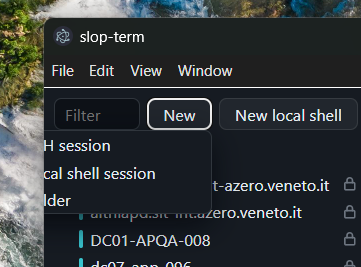

# 22 — Dropdown gets cut by window border (bug)

**What is wrong:** The menu under the "New" button opens past the left edge of the window and the window border clips it. The first letters of "SSH session", "Local shell session" and "Folder" are not visible.

**Screenshot:** 

**Blocked by:** none

**Status:** open

## Agent brief

**Category:** bug. **State:** ready-for-agent.

**Cause:** `.menu` in `src/renderer/index.css` is `position: absolute; right: 0; min-width: 160px`, anchored to its button. The "New" button is about 62px wide and starts about 100px into the 260px sidebar, after the Filter input. Right-aligned, the 160px menu reaches left of the sidebar and the window border clips it. Left-aligned to the button it would end near 263px and hit the `.tree` overflow on the right. The "New local shell" menu uses the same class, sits at the right, and must stay right-aligned.

**Fix:** Anchor the "New" menu to the toolbar, not to its button: a `menu-start` class on the "New" menu `<ul>` in `src/renderer/App.tsx` sets `left: 8px; right: auto`, `.tree-actions` becomes `position: relative`, and the `.new` wrapper that holds a `menu-start` menu becomes `position: static`. The menu then spans 8px to 168px of the sidebar whatever the button widths are. Leave the "New local shell" menu unchanged.

**Test seam:** `App` rendered against `FakeBackend`. jsdom has no layout and does not load `index.css`, so the test asserts the modifier class on the opened menu, and that the "New local shell" menu does not have it.

- [ ] The "New" dropdown stays fully inside the window at the narrow sidebar width shown in the screenshot.
- [ ] A renderer test opens the dropdown and checks that it is anchored to the toolbar's left edge (the modifier class), and that the "New local shell" menu is not.

## Test coverage

UI: `src/renderer/Folders.test.tsx`.

- Dropdown inside the window: no test can measure it. jsdom has no layout and does not load `index.css`, so the clip is invisible to it. The UI test "opens anchored to the left edge of the toolbar so it stays inside the window, unlike the New local shell menu" covers the cause: the "New" menu has the `menu-start` class (`left: 8px; right: auto`, anchored to the toolbar) and the "New local shell" menu does not.
- Renderer test of the alignment: the same UI test.
